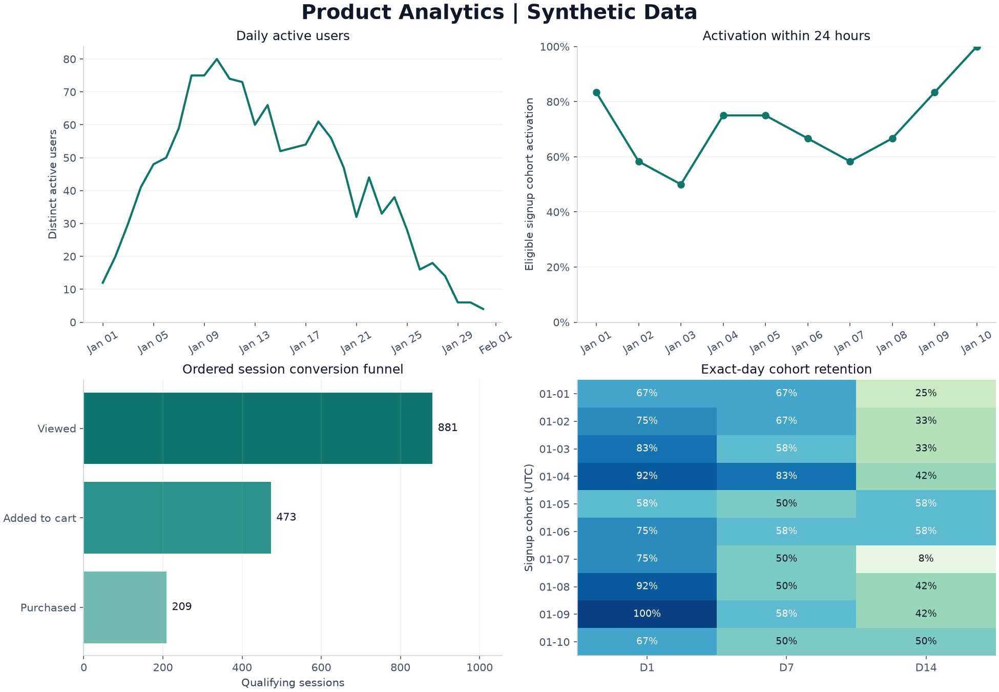

# Product Analytics Engineering Portfolio

An end-to-end product analytics system for ingesting synthetic application events, building reusable analytical models, and validating product metrics. The repository connects data engineering, product measurement, and responsible AI-assisted SQL review in one reproducible workflow.

**Implemented stack:** Python, SQL, SQLite, Git, and GitHub Actions. The local implementation includes automated tests, analytics models, CSV exports, a pipeline run audit, and an AI-assisted SQL evaluation workflow. Airflow, dbt, Snowflake, and Tableau are roadmap items, not deployed integrations.

No paid account, real customer records, API key, or third-party Python package is required for the core workflow. Optional static charts use Matplotlib. All event data is synthetic.

## Results preview



The generated dataset contains 3,248 accepted events across 120 synthetic users. Explore [the results report](docs/evidence/results.md), [metric CSVs](docs/evidence), and [the SQL review report](docs/evidence/ai_review_report.json). These outputs demonstrate the implementation, not real product performance.

## Product questions

- How many users are active each day?
- What share of signups activate within 24 hours?
- Where do sessions drop out of the view-to-cart-to-purchase funnel?
- How do D1, D7, and D14 retention differ by signup cohort?
- Which experiment participants have valid exposure and complete outcome windows?

## Start here

Read [the step-by-step guide](docs/STEP_BY_STEP.md), then run:

```bash
python -m unittest discover -s tests -v
python -m demo
```

Use Python 3.11 or newer. Run commands from this repository's root. Some Windows installations use `py` instead of `python`.

The demo generates inputs, loads and validates events, verifies replay safety, exports five metric tables, evaluates the AI-authored SQL, and writes a Markdown results report under `data/demo/exports`.

To regenerate the static chart preview:

```bash
python -m pip install -r requirements-viz.txt
python -m demo --figures
```

The generator prints its fixed synthetic-data clock. The pipeline uses this same clock for reproducible freshness checks; it is not claiming that generated events are current production data.

## Architecture

```text
Deterministic synthetic JSONL events
                 |
     Schema validation / quarantine
                 |
    Idempotent SQLite event inserts
       /                        \
Users / sessions / events    Quality checks + run audit
       |
SQL marts: DAU / activation / funnel / cohort retention
       |
CSV exports --> static charts / results report

AI-authored SQL candidate --> correctness tests --> review report
                                                    |
                                   Human approval still required
```

## Repository layout

```text
pipeline/           Synthetic generator, validation, ingestion, quality checks
analytics/          Metric SQL and CSV exporter
demo.py             One-command end-to-end execution
ai_review/          AI-authored candidate and executable review checks
tests/              Automated pipeline and analytics tests
docs/               Setup guide, event contract, metrics, operations, AI review
.github/workflows/  Local tests and integration smoke run
```

## Project scope

| Project | Implemented locally | Extension work |
|---|---|---|
| Product Event Analytics Pipeline | Event contract; quarantine; deduplication; late-event handling; repeatable backfills; user/session/event tables; quality checks; freshness checks; run log | Airflow orchestration; dbt models; Snowflake warehouse; deployed alerting |
| Product Engagement and Retention Analytics | DAU; activation; ordered funnel; cohort retention; experiment assignment/exposure/outcome datasets; CSV exports; static charts; results report | Tableau workbook; metric stakeholder review; statistical experiment analysis |
| Responsible AI-Assisted Data Development | AI-authored retention query; reference comparison; edge-case fixtures; read-only execution; privacy checklist; machine-readable report | Additional prompt evaluations; human review record; measured comparison against a manual workflow |

## Engineering decisions

- **Immutable event identifiers:** Exact replays are skipped; conflicting payloads are quarantined rather than overwriting accepted facts.
- **Explicit table grain:** Events use event_id; users use user_id; sessions use the user_id/session_id pair.
- **Late-event correctness:** Accepted late arrivals feed full model rebuilds. This favors straightforward correctness at demonstration scale over warehouse-scale efficiency.
- **Metric validity:** Funnels enforce event order, retention excludes immature observation windows, and experiment datasets preserve missing-exposure flags.
- **Reproducibility:** A seeded generator and fixed synthetic clock make data-quality and freshness checks repeatable.
- **Review safeguards:** AI-authored SQL is checked against reference results and expected-value fixtures; automated success is not human or production approval.

## Validation

The suite contains **16 tests** covering replay, quarantine, late arrivals, backfills, schema validation, timezone normalization, freshness, experiment assignments, analytics exports, chart generation, and metric edge cases. All 16 passed locally with the optional plotting dependency installed. The initial fresh load accepted **3,248 events**, skipped one replay, and quarantined two intentionally invalid records.

See [the verification record](docs/LOCAL_VERIFICATION.md) for reproducible results and [GitHub Actions](https://github.com/angelpraisypenumaka-afk/product-analytics-portfolio/actions) for hosted checks.

## Documentation

- [Setup and implementation guide](docs/STEP_BY_STEP.md)
- [Event contract and table grains](docs/EVENT_CONTRACT.md)
- [Metric definitions and assumptions](docs/METRICS.md)
- [Operational runbook and limitations](docs/RUNBOOK.md)
- [AI-assisted development and review methodology](docs/AI_REVIEW.md)

## Scope and limitations

This is a local portfolio implementation, not a production service. It does not include a deployed scheduler, warehouse access-role integration, a Tableau workbook, or production alert delivery. See the runbook for recovery and publication limitations, and the setup guide for the cloud-stack roadmap.
